# Technical architecture

This document explains how the app is built: the features, the files and functions
behind each of them, the flow of the data from the raw file to the screen, and what
is cached or kept in the session.

## 1. Main idea: the analysis is separated from the interface

```
src/        shared logic, NO Streamlit inside (can be tested alone)
ui.py       Streamlit helpers shared by all the pages (cache, sidebar, captions)
app.py      entry point: menu and common sidebar
views/      one file per page: they only call src/ and ui.py, then display
tests/      automatic tests of src/
notebooks/  shared explorations of the group
docs/       documentation (this file, data cleaning, harmonisation)
```

A view never computes a statistic by itself: it calls a function of `src/analysis.py`,
gives the result to a function of `src/charts.py`, and displays it with `ui.show_chart`.

## 2. Files and their role

| File | Role | Main functions |
|---|---|---|
| `src/config.py` | Settings: sponsor, years, URLs of the data, rules (30 respondents, salary bounds), colors | constants only |
| `src/data.py` | Download the raw files once, read them | `download_year`, `read_survey`, `read_schema` |
| `src/labels.py` | Short labels, order of the answers, 2025 → 2026 harmonisation, role families | dicts only |
| `src/cleaning.py` | Cleaning and harmonisation of one year | `clean_survey`, `clean_salary`, `remove_outliers_by_country`, `check_clean_data` |
| `src/population.py` | The population behind every figure | `paid_population`, `focus_country`, `comparison_group`, `describe_population` |
| `src/analysis.py` | Statistics: small tables, no display | `salary_summary`, `median_by_group`, `compare_groups`, `evolution`, `count_multiselect`, `median_by_answer` |
| `src/charts.py` | Plotly figures with the common style | `bar_ranking`, `bars_compare`, `lines_compare`, `dumbbell_years`, `choropleth` |
| `ui.py` | Streamlit layer shared by the pages | `load_survey`, `load_paid` (cached), `comparison_selector`, `filters_row`, `remembered_multiselect`, `show_chart`, `show_population`, `footer` |
| `app.py` | Menu (`st.navigation`) and common sidebar | — |
| `views/dashboard.py` | Main dashboard and message for the sponsor | — |
| `views/axis_*.py` | One deeper analysis axis per member | — |
| `views/axis_4_skills.py` | Axis 4: technologies and AI linked to salaries (6 tabs) | uses `median_by_answer`, `compare_shares`, `evolution_of_shares`, `bars_compare`, `filters_row` |
| `data/countries.csv` | Reference table made by the group: ISO3 code and continent of each country | — |

## 3. Features

| Feature | Where |
|---|---|
| Download the data from the official archive (never committed) | `src/data.py` → `download_year` |
| Clean and harmonise 2025 and 2026 | `src/cleaning.py` → `clean_survey` |
| Choose the comparison group (EU, Europe, world, one country), same on all pages | `ui.py` → `comparison_selector`, `get_comparison` |
| Main dashboard: message computed from the data, key figures, 3 charts | `views/dashboard.py` |
| Show the population of every figure (who, year, n) | `src/population.py` → `describe_population`, `ui.py` → `show_chart`, `show_population` |
| See the data behind every chart (table view) | `ui.py` → `show_chart` |
| 2025 vs 2026 comparison on harmonised questions | `src/analysis.py` → `evolution`, `evolution_of_groups` |
| Filters of each axis, in one row above the charts | `ui.py` → `filters_row` |
| Clear message if the data cannot be downloaded | `ui.py` → `load_survey` |
| Five axes of deeper analysis | `views/axis_1_geography.py` … `views/axis_5_work_conditions.py` |

## 4. Axis 4 - Skills and AI (example of an axis)

| View (tab) | Population | Logic (`src/analysis.py`) | Chart (`src/charts.py`) |
|---|---|---|---|
| Technologies and salary | Salaries in France, people who answered the question on the chosen family | `median_by_answer` | `bar_ranking` (blue = above the median) |
| Most used | All respondents, France vs comparison group | `compare_shares` | `bars_compare` (%) |
| AI and salary | Salaries, France vs comparison; then France at equal experience | `compare_groups` | `bars_compare`, `lines_compare` |
| Opinions on AI | All respondents who answered (one answer each) | `compare_shares(multiselect=False)` | `bars_compare` (%) |
| AI tools | All respondents who answered | `compare_shares` | `bars_compare` (%) |
| Trends and wishes | France 2025 and 2026 (common languages only); used vs wanted languages | `evolution_of_shares`, `count_multiselect` | `dumbbell_years` (%), `bars_compare` |

Filters of the axis (experience, role family) and the choice of each tab are kept in
`st.session_state` (`filters_row`, `remembered_radio`). Exploration: `notebooks/axis_4_skills_and_ai.ipynb`.

## 5. Data flow

```mermaid
flowchart LR
    A[Stack Overflow archive<br>on GitHub] -->|download once| B[data/raw/<br>survey_2025.csv<br>survey_2026.csv]
    B -->|read_survey<br>remove duplicates| C[raw columns]
    C -->|clean_survey<br>labels, salary, harmonisation, checks| D[clean table<br>one per year]
    D -->|load_survey<br>st.cache_data| E[in memory]
    E -->|paid_population<br>comparison_group| F[population]
    F -->|analysis.*| G[small result table]
    G -->|charts.*| H[Plotly figure]
    H -->|ui.show_chart| I[page + population + data table]
```



1. **Download** (`src/data.py`): the first time, the raw CSV files of 2025 and 2026
   are downloaded from the official archive into `data/raw/` (ignored by git).
2. **Read** (`read_survey`): the file is read by pieces of 5,000 rows to save memory.
   Exact duplicates (same answers to all the questions) are removed.
3. **Clean** (`clean_survey`): short labels, order of the answers, countries,
   role families, experience, salary, 2025 → 2026 harmonisation, then automatic checks.
   Rules: [DATA.md](DATA.md). Harmonisation: [HARMONISATION.md](HARMONISATION.md).
4. **Population** (`src/population.py`): the views select the people behind a figure
   (salaries only, France, comparison group, filters).
5. **Analysis** (`src/analysis.py`): a small table (n, median, quartiles, reliable).
6. **Chart** (`src/charts.py`) and **display** (`ui.show_chart`): the figure, its population
   and its data.

## 6. Cache and session

| What | How | Why |
|---|---|---|
| Raw files | On the disk, in `data/raw/` | Downloaded only once |
| Clean table of each year | `@st.cache_data` on `ui.load_survey(year)` | Cleaning takes a few seconds: it is done once, then shared by all pages and all users |
| Paid population of each year | `@st.cache_data` on `ui.load_paid(year)` | Used by every page |
| Comparison group chosen by the user | `st.session_state["comparison"]` (key of the sidebar selectbox) | Kept when the user changes page |
| Filters of an axis | `ui.filters_row(df, prefix, columns)`: widget key `<prefix>_<column>`, value also saved in `st.session_state["saved_<prefix>_<column>"]` | Each axis has its own filters, kept when the user changes page (Streamlit forgets the value of a widget that is not on the screen) |

We do not use `persist="disk"` for the cache: if the cleaning code changes, a disk cache
could give old results. After a change in `src/`, restart the app (or press `C` then *Clear cache*).

## 7. Rules for the charts

- France is always blue (`#2a78d6`), the comparison group always orange (`#eb6834`),
  the context grey. Colors come from a palette checked for color blindness.
- The number of respondents (n) is in every tooltip, and the population under every chart.
- Groups with fewer than 30 respondents are hidden or drawn with empty markers.
- Median, not mean, for salaries. One axis per chart. Bars start at 0.
- Every chart has a "See the data" table.

## 8. Git workflow

- `main`: common core (data, population, shared logic, main dashboard, notebooks, docs).
- `axis-1` … `axis-5`: one branch per axis, one member each, merged into `main` when ready.
- Before a merge: `python -m pytest` must pass and the app must start.
